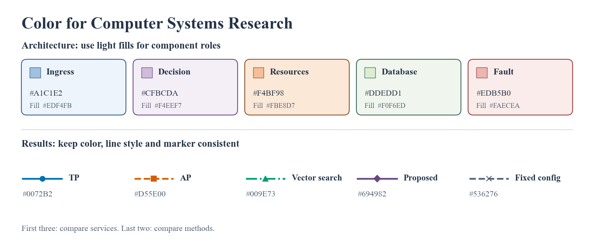

# Database Research Figures

A Codex skill, a consistent paper palette, and a compact SVG icon library for database and computer-systems research. Architecture diagrams show component boundaries and concrete endpoints. Results plots preserve the meaning of series across figures.



## Install the skill

Clone the repository into your Codex skills directory under the name `scientific-figure-style`.

```sh
git clone https://github.com/BaiBoHao/database-research-figures.git "$HOME/.codex/skills/scientific-figure-style"
```

On Windows PowerShell:

```powershell
git clone https://github.com/BaiBoHao/database-research-figures.git (Join-Path $env:USERPROFILE '.codex\skills\scientific-figure-style')
```

Then ask Codex: “Use `$scientific-figure-style` to draw the read/write paths, replication links, and control signals in this primary–replica system. Deliver one editable POS file.” If a local skill with this name already exists, review it before copying or updating its files.

## Use the assets

| Resource | Purpose |
| --- | --- |
| [Skill instructions](SKILL.md) | Typography, architecture layout, series encoding, and delivery checks |
| [Color definitions](assets/palette.json) | Soft architecture colors and stable experiment-series styles |
| [Matplotlib stylesheet](assets/paper.mplstyle) | White background, print-friendly typography, and line defaults |
| [Icon catalog](assets/icons/ATTRIBUTION.md) | 20 original Lucide SVGs, grouped by systems role |
| [Primary–replica POS example](examples/primary-replica.pos) | Editable layout for a generic database cluster |
| [Related drawing workflows](references/related-workflows.md) | Source-based layouts, final-size review, and figure tools |

       

The default diagram deliverable is one `.pos` file. In [ProcessOn](https://www.processon.com/support/file-import), import the file to edit labels, nodes, or connectors. For an offline check of the file structure and embedded resources, run `python scripts/check_pos.py examples/primary-replica.pos`. Actual editor import is a separate check.

To use the plot stylesheet in a Python script, call `plt.style.use("assets/paper.mplstyle")`. Bind series styles to service or method names using `assets/palette.json` so ordering changes do not change color meanings. `python scripts/preview_palette.py` regenerates the palette card and checks color contrast. The preview script requires Matplotlib.

## Contributing

Keep the palette, documentation, and preview aligned when changing a color. For a new icon, record its original source and keep its license. For diagrams, check reading order, line endpoints, and readability at the final paper width.

## License and credits

Repository-authored material is [MIT licensed](LICENSE). Bundled Lucide icons retain the [upstream license](assets/icons/LICENSE). The icon library contains generic systems symbols; use your own authorized image if you need a product mark.

The experimental palette follows [Okabe–Ito Color Universal Design](https://jfly.uni-koeln.de/color/index.html). Figure accessibility guidance comes from the [Nature research figure guide](https://research-figure-guide.nature.com/figures/preparing-figures-our-specifications/). For POS geometry, see [generate-pos-flowchart](https://github.com/lilyjem/generate-pos-flowchart) and the ProcessOn import documentation.
